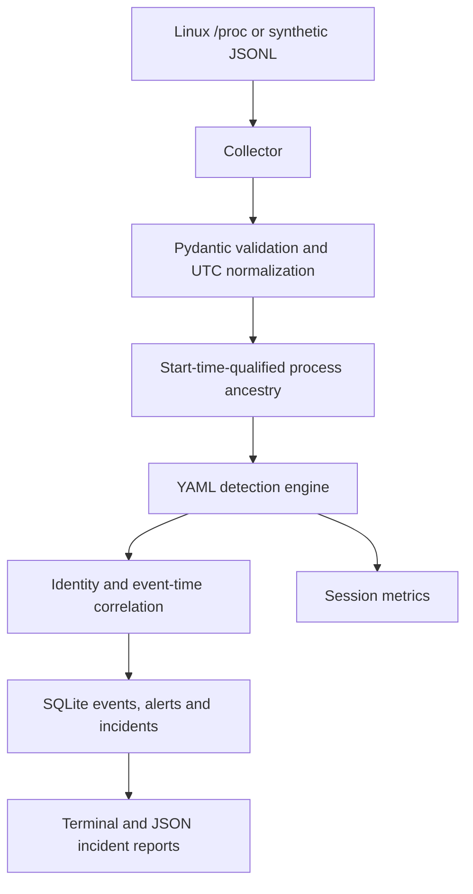

# Linux Runtime Threat Detection Engine

A small Python 3.11+ prototype that turns Linux process observations and replayed
telemetry into explainable, evidence-backed incidents. Built from scratch, without
Falco, Wazuh or another detection engine.

**Detection and reporting only.** It never kills a process, blocks a connection,
changes a firewall, executes collected arguments or remediates a finding. A rule
match is an indicator for review, not proof of an attack. This is a teaching and
engineering prototype, not production endpoint protection.

## Why this exists

Individual security events lose context. A shell launched by an office program,
a sensitive-file access and a related child process can deserve one investigation,
not a pile of disconnected alerts. This project demonstrates that pipeline with
inert synthetic data and a real read-only `/proc` discovery collector.

## Features

- Read-only `/proc` snapshots with PID + start ticks + boot ID identity, race/error handling,
  parent metadata and opt-in argument collection.
- Validated JSONL replay, bad-record counters and optional event-time sorting.
- Six YAML rules, explicit matching reasons and LOW through CRITICAL severity support.
- Process ancestry with missing-parent markers, exit markers and cycle guards.
- Conservative time-window correlation and evidence-preserving alert deduplication.
- Atomic SQLite event/alert/incident persistence, terminal reports and JSON export.
- Measured per-session counters and reproducible synthetic benchmarks.
- pytest, Ruff, strict mypy, a wheel smoke test and GitHub Actions configuration.

Live collection is **process discovery by polling**, not complete process-event capture.
Live FILE_ACCESS, PRIVILEGE_CHANGE and NETWORK_CONNECTION collection is **not**
implemented. Those event types work through replay. Missing telemetry is never inferred.

## Architecture



Ancestry is updated before rule evaluation so a bound parent's observed name is
available to the rules. Components remain independently testable.

## Install

You need Python 3.11 or newer. Live monitoring additionally requires Linux -
the collector reads `/proc`. Replay, demonstrations, reports and tests run
wherever Python 3.11 runs; the project is developed and CI-tested on Linux, so
treat other operating systems as replay-only and unverified.

### Ubuntu

Ubuntu 24.04 LTS ships `python3` 3.12, and newer releases ship 3.13 or 3.14
(per the Ubuntu package index), so the distribution packages are enough:

```bash
sudo apt update
sudo apt install -y python3 python3-venv
python3 --version   # must print 3.11 or newer
```

On Ubuntu 22.04 LTS the default `python3` is 3.10 - too old - and the standard
repositories carry no newer Python. On 22.04, skip apt and use the uv route
below; it installs its own Python 3.11.

Then, from the repository root:

```bash
python3 -m venv .venv
source .venv/bin/activate
python -m pip install -e '.[dev]'
```

The install also registers a `runtime-engine` command equivalent to
`python -m runtime_engine.main`.

The [uv](https://docs.astral.sh/uv/) route installs a suitable Python and the
locked dependencies in one step, on any release including 22.04:

```bash
curl -LsSf https://astral.sh/uv/install.sh | sh
uv python install 3.11
uv sync --extra dev --locked
```

Then either `source .venv/bin/activate` or prefix every command with `uv run`.

Production dependencies are just Pydantic and PyYAML; argparse, logging and
SQLite come from Python. No root access is needed to install or run.

## Quick start

Run from the repository root after installation. Global options go **before** the command.
Use a new database for each independent demo because events are deduplicated across sessions.

```bash
python scripts/generate_scenario.py
python -m runtime_engine.main --db demo.db replay --input datasets/chain.jsonl
python -m runtime_engine.main --db demo.db incidents
python -m runtime_engine.main --db demo.db incident --id INC-0001
python -m runtime_engine.main --db demo.db export --id INC-0001 --format json --output incident.json
python -m runtime_engine.main --db demo.db metrics
python -m runtime_engine.main rules
python -m runtime_engine.main --config config/default.yaml --rules rules/default_rules.yaml rules
```

`--output` refuses to overwrite an existing file. JSON also goes to stdout without it.
Monitor a Linux machine you are authorized to inspect:

```bash
python -m runtime_engine.main --db monitor.db monitor --duration 10
# Omit --duration to continue until Ctrl-C. Default poll interval is 2 seconds.
# Only if needed and authorized: monitor --include-cmdline
```

One Ctrl-C stops the monitor cleanly: it finishes the current poll, writes its
final session summary and exits. SQLite writes are atomic, so an interrupted run
still leaves a consistent database. Processes the collector cannot read (other
users' processes under `hidepid`, or a restricted container) are skipped and
counted as collector errors; they are never fatal.

The first snapshot reports all visible processes as newly observed, not as proof
that they just started. The engine writes only its own SQLite/report outputs.
Do not run as root merely to improve visibility. Command lines may contain secrets;
they are off by default. Never publish a monitoring database or live report.

## Reproducible demonstrations

These commands only read JSONL; no listed programs, network destinations or file
operations in the synthetic records are executed.

```bash
python -m runtime_engine.main --db benign.db replay --input datasets/benign.jsonl
python -m runtime_engine.main --db shell.db replay --input datasets/shell.jsonl
python -m runtime_engine.main --db chain.db replay --input datasets/chain.jsonl
python -m runtime_engine.main --db sensitive.db replay --input datasets/sensitive.jsonl
python -m runtime_engine.main --db repeated.db replay --input datasets/repeated.jsonl
python -m runtime_engine.main --db unrelated.db replay --input datasets/unrelated.jsonl
```

| Dataset | Unique events | Rule matches | Incidents | Expected behavior |
|---|---:|---:|---:|---|
| benign | 2 | 0 | 0 | Ordinary terminal shell is not flagged |
| shell | 1 | 1 | 1 | Office-parent shell indicator |
| chain | 6 | 6 | 1 | Five matched events, six rules, one related incident |
| sensitive | 1 | 1 | 1 | Sensitive-file event indicator |
| repeated | 3 | 3 | 1 | Two alert repeats collapsed, one exact event duplicate ignored |
| unrelated | 2 | 2 | 2 | Same sensitive file does not merge unrelated processes |

`datasets/sample_events.jsonl` combines these independent, synthetic-host scenarios.
`--sort` buffers replay data and sorts timestamps. Without it, file order is preserved;
late events can join a compatible existing incident but do not retroactively merge reports.

## Example incident

The chain dataset produces a report like this (IDs/timestamps below are synthetic):

```text
INCIDENT: INC-0001
SEVERITY: HIGH
STATUS: OPEN
SUMMARY: Suspicious runtime activity requires review
EVENTS: 5
TIMELINE:
  2026-01-01T00:00:02+00:00 PROCESS_START PID 110 (shell)
  2026-01-01T00:00:03+00:00 FILE_ACCESS PID 110
  2026-01-01T00:00:04+00:00 PROCESS_START PID 120 (transfer utility)
  2026-01-01T00:00:05+00:00 NETWORK_CONNECTION PID 120
  2026-01-01T00:00:06+00:00 PRIVILEGE_CHANGE PID 110
ANCESTRY:
  soffice (PID 100) -> bash (PID 110) -> curl (PID 120)
```

The actual terminal report includes each rule reason, qualified process identities,
ancestry and full normalized JSON evidence. JSON export also separates matched
supporting events from benign ancestor context. Nothing asserts malware execution,
file contents, a successful download or exfiltration.

## Test and benchmark

```bash
ruff check .
ruff format --check .
mypy src
pytest -q --cov=runtime_engine --cov-report=term-missing
python -m build
python scripts/benchmark.py --events 2000
```

See [testing](docs/TESTING.md), [measured benchmark](docs/benchmark.json) and the
[engineering report](docs/ENGINEERING_REPORT.md). Local checks are not a claim that
hosted CI has run. The workflow tests Linux on Python 3.11 and 3.13.

## Documentation and extension

- [Architecture and correlation strategy](docs/ARCHITECTURE.md)
- [Rules, tuning and MITRE scope](docs/DETECTION_RULES.md)
- [Event schema](docs/EVENT_SCHEMA.md)
- [Telemetry, privacy and scale limits](docs/LIMITATIONS.md)
- [Original requested requirements](docs/REQUIREMENTS.md)
- [Contributing](CONTRIBUTING.md) and [security reporting](SECURITY.md)

Roadmap: an authorized audit-event collector, optional eBPF adapter, bounded caches
and retention, persistent cross-session correlation, richer allowlists and resource
relationships, a versioned schema/migrations layer, and controlled performance studies.
There is deliberately no automated remediation roadmap in this prototype.

## License

MIT. See [LICENSE](LICENSE).
