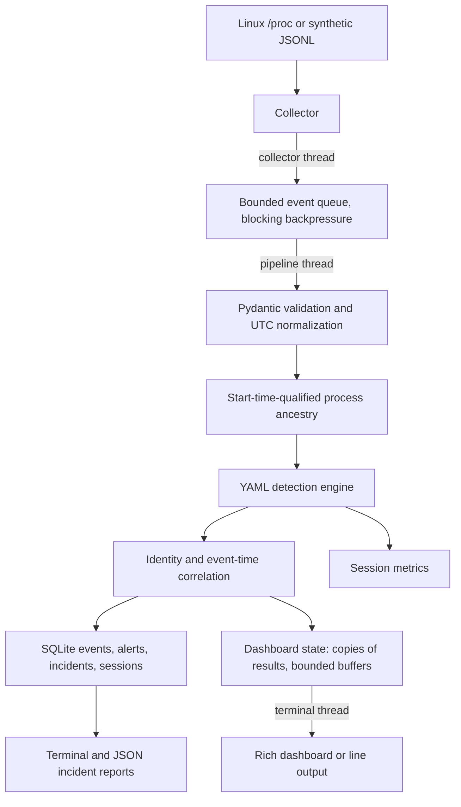

# Linux Runtime Threat Detection Engine

A small Python 3.11+ prototype that turns Linux process observations and replayed
telemetry into explainable, evidence-backed incidents. Built from scratch, without
Falco, Wazuh or another detection engine.

**Detection and reporting only.** It never kills a process, blocks a connection,
changes a firewall, executes collected arguments or remediates a finding. A rule
match is an indicator for review, not proof of an attack. This is a teaching and
engineering prototype, not production endpoint protection.

## Why this exists

Individual security events lose context. A shell launched by an office program,
a sensitive-file access and a related child process can deserve one investigation,
not a pile of disconnected alerts. This project demonstrates that pipeline with
inert synthetic data and a real read-only `/proc` discovery collector.

## Features

- Read-only `/proc` snapshots with PID + start ticks + boot ID identity, race/error handling,
  parent metadata and opt-in argument collection.
- Validated JSONL replay, bad-record counters and optional event-time sorting.
- Six YAML rules, explicit matching reasons and LOW through CRITICAL severity support.
- Process ancestry with missing-parent markers, exit markers and cycle guards.
- Conservative time-window correlation and evidence-preserving alert deduplication.
- Atomic SQLite event/alert/incident persistence, terminal reports and JSON export.
- Measured per-session counters and reproducible synthetic benchmarks.
- An interactive Rich terminal dashboard for live monitoring with process, incident,
  event, alert and metrics inspection, a final session report and persistent session
  history (see [Live terminal monitoring](#live-terminal-monitoring)).
- pytest, Ruff, strict mypy, a wheel smoke test and GitHub Actions configuration.

Live collection is **process discovery by polling**, not complete process-event capture.
Live FILE_ACCESS, PRIVILEGE_CHANGE and NETWORK_CONNECTION collection is **not**
implemented. Those event types work through replay. Missing telemetry is never inferred.

## Architecture



Ancestry is updated before rule evaluation so a bound parent's observed name is
available to the rules. Components remain independently testable. The terminal layer
only reads copies of pipeline results; it cannot change detections or incidents.

## Install

On Linux with Python 3.11 or later:

```bash
python3.11 -m venv .venv
source .venv/bin/activate
python -m pip install -e '.[dev]'
```

Alternatively, with [uv](https://docs.astral.sh/uv/), `uv sync --extra dev --locked`
uses the committed dependency lock. Production dependencies are Pydantic, PyYAML and
Rich (terminal rendering); argparse, logging and SQLite come from Python. No root
access is needed.

## Quick start

Run from the repository root after installation. Global options go **before** the command.
Use a new database for each independent demo because events are deduplicated across sessions.

```bash
python scripts/generate_scenario.py
python -m runtime_engine.main --db demo.db replay --input datasets/chain.jsonl
python -m runtime_engine.main --db demo.db incidents
python -m runtime_engine.main --db demo.db incident --id INC-0001
python -m runtime_engine.main --db demo.db export --id INC-0001 --format json --output incident.json
python -m runtime_engine.main --db demo.db metrics
python -m runtime_engine.main rules
python -m runtime_engine.main --config config/default.yaml --rules rules/default_rules.yaml rules
```

`--output` refuses to overwrite an existing file. JSON also goes to stdout without it.
Monitor a Linux machine you are authorized to inspect:

```bash
python -m runtime_engine.main --db monitor.db monitor --duration 10
# Omit --duration to continue until q or Ctrl-C. Default poll interval is 2 seconds.
# Only if needed and authorized: monitor --include-cmdline
# Previous JSON-only output (for scripts): monitor --duration 10 --json
```

The first snapshot reports all visible processes as newly observed, not as proof
that they just started. The engine writes only its own SQLite/report outputs.
Do not run as root merely to improve visibility. Command lines may contain secrets;
they are off by default. Never publish a monitoring database or live report.

`monitor` now opens the interactive dashboard on a terminal and prints a session
report when it stops. Scripts that parsed its JSON stdout should add `--json`
(log lines then go to stderr). `replay` keeps printing JSON metrics unless
`--summary` is given.

## LIVE TERMINAL MONITORING

### Start monitoring

```bash
python -m runtime_engine.main --db monitor.db monitor           # dashboard, until q/Ctrl+C
python -m runtime_engine.main --db monitor.db monitor --duration 60
python -m runtime_engine.main --db monitor.db monitor --verbosity verbose
python -m runtime_engine.main --db monitor.db monitor --refresh 0.5
python -m runtime_engine.main --db monitor.db monitor --no-dashboard   # log lines
```

The installed entry point `runtime-engine` is equivalent to
`python -m runtime_engine.main`. The dashboard requires an interactive terminal on both
stdin and stdout (and `TERM` not `dumb`). Under pipes, CI, `nohup` or redirected input it
automatically falls back to line output, so the same command works over SSH, in tmux or
screen, and in scripts. Resize the terminal freely; small terminals get a compact view.

Verbosity (`--verbosity`, default `normal`):

| Level | Shows |
|---|---|
| `quiet` | rule matches, incidents, monitoring errors, start/stop |
| `normal` | plus newly discovered processes, the baseline summary, first-poll telemetry gaps |
| `verbose` | plus every baseline process, repeated (deduplicated) matches, every telemetry gap |
| `debug` | plus internal diagnostics, in a separate panel labelled as not security events |

Each stream entry shows the event time with milliseconds, a level (`INFO`, `NOTICE`,
`WARNING` for a rule match, `ALERT` for a correlated incident, `ERROR` for a monitoring
failure, `DEBUG`), the event type, PID, PPID, process name, source and detection status.
Long values are truncated in the stream and shown in full on inspection pages. Colours
always come with a text label; `NO_COLOR` is honoured.

This is the real dashboard 9 seconds into a session, captured from a pseudo-terminal at
150x50 (hostname redacted, lower table rows trimmed). The detection was produced by a
benign test: a copy of `/bin/bash` run from `/tmp/rte-test/` (rule RT002) that started
`curl` reading `file:///dev/zero` (rule RT005). Both matched processes are linked by
ancestry, so the engine reports one incident rather than two:

```text
╭──────────────────────────────────────────────── LINUX RUNTIME THREAT DETECTION ENGINE (read-only) ─────────────────────────────────────────────────╮
│ STATUS: RUNNING   MODE: LIVE   DURATION: 00:00:09   STARTED: 00:52:09   VERBOSITY: normal                                                          │
│ HOST: <host>          ENGINE PID: 741899   SESSION: SES-20261110-192209-bcf0f7                                                                     │
│ Telemetry: /proc polling every 2s (process discovery only; no live file, network or privilege events)   Last poll #5: 00:52:18 (79 ms)             │
╰────────────────────────────────────────────────────────────────────────────────────────────────────────────────────────────────────────────────────╯
╭─ SYSTEM OVERVIEW ──────────────────────────────╮╭─ DETECTION SEVERITY ──────────╮╭─ RECENT INCIDENTS ──────────────────────────────────────────────╮
│ Events Observed                         523    ││  SEVERITY  MATCHES  ALERTS    ││  ID           SEVERITY        ALERTS  WINDOW    RULES           │
│ Events Processed                        523    ││  CRITICAL        0       0    ││  INC-0001     MEDIUM               2  ACTIVE    RT002,RT005     │
│ Event Queue             0/10,000 (peak 519)    ││  HIGH            0       0    ││                                                                 │
│ Suspicious Detections                     2    ││  MEDIUM          1       1    ││                                                                 │
│ Unique Alerts                             2    ││  LOW             1       1    ││                                                                 │
│ Active Incidents                     1 of 1    ││ matches = every rule hit      ││                                                                 │
│ Suppressed Duplicates                     0    ││ alerts = after deduplication  ││                                                                 │
│ Events Dropped                            0    ││                               ││                                                                 │
│ Telemetry Gaps/Poll   359 fields, 0 skipped    ││                               ││                                                                 │
╰────────────────────────────────────────────────╯╰───────────────────────────────╯╰─────────────────────────────────────────────────────────────────╯
╭─ SECURITY ALERT (rule match - an indicator for review, not proof) ─────────────────────────────────────────────────────────────────────────────────╮
│ [MEDIUM] Execution from temporary location, Transfer u...  rule RT002, RT005  PID 741950 curl  incident INC-0001  (2 matches coalesced)            │
│ Press [i] to inspect the associated incident, [r] for all alerts.                                                                                  │
╰────────────────────────────────────────────────────────────────────────────────────────────────────────────────────────────────────────────────────╯
╭─ RECENT PROCESSES (NORMAL = no rule matched) ────────────╮╭─ LIVE SECURITY EVENTS (verbosity: normal) ─────────────────────────────────────────────╮
│      PID     PPID  PROCESS   UID    STATUS               ││ [00:52:09.845] NOTICE   MONITORING_STARTED                                             │
│   741949   741885  bash      1000   SUSPICIOUS (MEDIUM)  ││     SESSION=SES-20261110-192209-bcf0f7 TELEMETRY=/proc polling every 2s (process disc… │
│   741950   741949  curl      1000   SUSPICIOUS (LOW)     ││ [00:52:09.950] NOTICE   BASELINE_SNAPSHOT                                              │
│   741951   741949  sleep     1000   NORMAL               ││     PROCESSES_VISIBLE=520 NOTE=pre-existing processes; first observation, not new sta… │
│       99        2  kcompac…  0      NORMAL (baseline)    ││ [00:52:09.950] NOTICE   PARTIAL_TELEMETRY [TELEMETRY GAP]                              │
│       97        2  kworker…  0      NORMAL (baseline)    ││     POLL=1 FIELDS_UNREADABLE=359 ENTRIES_SKIPPED=0 CAUSE=permission denied or process… │
│       94        2  oom_rea…  0      NORMAL (baseline)    ││ [00:52:14.039] INFO     PROCESS_START                                                  │
│      936        2  kworker…  0      NORMAL (baseline)    ││     PID=741949 PPID=741885 PROCESS=bash UID=1000 EXE=/tmp/rte-test/bash SOURCE=proc S… │
│    93527    17599  opera     1000   NORMAL (baseline)    ││ [00:52:14.039] WARNING  RULE_MATCH [RULE MATCH]  SEVERITY=MEDIUM                       │
│      935        2  kworker…  0      NORMAL (baseline)    ││     PID=741949 PROCESS=bash RULE=RT002 NAME=Execution from temporary location SEVERIT… │
│      934        2  kworker…  0      NORMAL (baseline)    ││ [00:52:14.039] ALERT    INCIDENT_CREATED [CORRELATED INCIDENT]  SEVERITY=MEDIUM        │
╰──────────────────────────────────────────────────────────╯╰────────────────────────────────────────────────────────────────────────────────────────╯
[h] Help  [p] Inspect process  [i] Inspect incident  [e] Inspect events  [m] Metrics  [r] Recent alerts  [q] Stop monitoring  Ctrl+C: graceful stop
```

"Suspicious Detections" counts every rule match; "Unique Alerts" counts them after
deduplication; "Active" incidents are those whose correlation window is still open, so
related evidence can still join. "Telemetry Gaps/Poll" counts optional fields (usually
other users' executable paths) the collector could not read in the last poll.

### Commands while monitoring

Press a key; no Enter is needed on the dashboard. Pages use normal line input and
blank input returns to the dashboard. **Monitoring continues while any page is open**;
only rendering pauses.

| Key | Action |
|---|---|
| `h` | Help, category legend and telemetry scope |
| `p` | Inspect a process |
| `i` | Inspect an incident |
| `e` | Inspect recent events with filters |
| `m` | Live metrics (queue, latency, throughput, collector errors, memory) |
| `r` | All alerts of the session; also dismisses the alert pop-up |
| `q` | Stop gracefully and print the session report |
| Ctrl+C | Same as `q` (also SIGTERM/SIGHUP). A second Ctrl+C while stopping forces the stop |

**Inspect a suspicious process (`p`).** A list of processes with rule matches is shown;
enter any observed PID. If a PID was used by several identities (PID reuse), you choose
by start time. The page shows identity (boot ID + PID + kernel start ticks), executable,
command line (only with `--include-cmdline`), UID, start time derived from boot time,
first observation, triggered rules with matched conditions, stored events, ancestry and
related incidents. **LIVE STATUS** is `RUNNING` only if `/proc/PID/stat` still has the
same start ticks on the same boot; otherwise the page says the data is `HISTORICAL` and
never reads the reused PID. Actions: parent, children, complete ancestry, alerts,
incidents, back.

**View process ancestry.** Choose action `3` on a process page for the full tree with
start tokens and executables. Edges exist only when the child reported its parent's PID
*and* start ticks; unobserved parents are marked `[not observed]`.

**Inspect an incident (`i`).** Pick an ID (`INC-0001` or just `1`). The page shows
severity (the highest severity among its rule matches), status, first/last observation,
related processes, rules, the evidence timeline, the process tree and **WHY WAS THIS
FLAGGED?**: each rule's description, its exact conditions and the matched evidence.
Actions: all related events (supporting vs. ancestor context), process details, complete
JSON evidence, JSON export (default `reports/generated/INC-xxxx-<time>.json`, mode 0600,
never overwrites), back. An incident is a grouping for review, not a confirmed attack.

**Inspect recent events (`e`).** Enter filters such as
`pid=1234 name=bash type=PROCESS_START severity=MEDIUM since=10m until=14:05
incident=INC-0001 kind=match` (`kind` is `observed`, `match` or `incident`), then a row
number for the full normalized event, the rule matches on it and its incidents, which
are shown as separate sections.

### Stopping and the session report

On `q`, Ctrl+C, SIGTERM, SIGHUP or `--duration`, the collector stops first; the pipeline
then finishes every event already accepted into the queue (each one is committed in its
own SQLite transaction), and only then is the report printed and the session saved.
A real report from the session above (`session --id` prints the same report later;
host and home path redacted, 100 columns):

```text
────────────────────────── MONITORING SESSION SES-20261110-192209-bcf0f7 ───────────────────────────
STATUS: STOPPED GRACEFULLY
SESSION INFORMATION ────────────────────────────────────────────────────────────────────────────────
Session ID                      SES-20261110-192209-bcf0f7
Started At                      2026-11-11 00:52:09.840 +0530
Stopped At                      2026-11-11 00:53:02.373 +0530
Duration                        00:00:52
Monitoring Mode                 LIVE
Stop Reason                     q command
Host                            <host>
Telemetry                       /proc polling every 2s (process discovery only; no live file,
                                network or privilege events)
EVENT STATISTICS ───────────────────────────────────────────────────────────────────────────────────
Total Events Observed           525
Events Processed                525
Duplicate Events Ignored        0
Events Rejected                 0
Events Dropped                  0
Unprocessed at Shutdown         0
Polls Completed                 26
Collector Read Errors           9,311 cumulative over all polls: 9,311 optional fields unreadable
                                (e.g. other users' executable paths), 0 entries skipped
SECURITY STATISTICS ────────────────────────────────────────────────────────────────────────────────
Total Detections (rule matches)  2
Unique Alerts                    2
Duplicate Alerts Suppressed      0
Incidents Generated              1
SEVERITY BREAKDOWN ─────────────────────────────────────────────────────────────────────────────────
  SEVERITY    RULE MATCHES    UNIQUE ALERTS
  CRITICAL               0                0
  HIGH                   0                0
  MEDIUM                 1                1
  LOW                    1                1
TOP SUSPICIOUS PROCESSES ───────────────────────────────────────────────────────────────────────────
  PID       PROCESS    ALERTS    MATCHES    SEVERITY    INCIDENTS
  741949    bash       1         1          MEDIUM      INC-0001
  741950    curl       1         1          LOW         INC-0001
INCIDENTS GENERATED ────────────────────────────────────────────────────────────────────────────────
  ID          SEVERITY    ALERTS    EVENTS    RULES           TITLE
  INC-0001    MEDIUM      2         2         RT002, RT005    Suspicious runtime activity requires
                                                              review
Incidents are indicators for review, not confirmed compromises.
PERFORMANCE ────────────────────────────────────────────────────────────────────────────────────────
Average Processing Latency       4.518 ms
P95 Processing Latency           5.921 ms (over 525 events)
Maximum Processing Latency       16.514 ms
Events Per Second (wall time)    9.99
Pipeline Events Per Second       221.31
Peak Memory                      42.8 MiB (peak RSS)
Queue Peak / Backpressure Waits  519 / 0
Render Errors                    0
PERSISTENCE ────────────────────────────────────────────────────────────────────────────────────────
Database Location               /tmp/rte-live.db
Incident Reports                ~/.../linux-runtime-threat-engine/reports/generated
Reports Exported This Session   ~/.../linux-runtime-threat-engine/reports/generated/INC-0001-20261111T005223.json
NEXT COMMANDS ──────────────────────────────────────────────────────────────────────────────────────
runtime-engine --db /tmp/rte-live.db sessions
runtime-engine --db /tmp/rte-live.db session --id SES-20261110-192209-bcf0f7
runtime-engine --db /tmp/rte-live.db incidents
runtime-engine --db /tmp/rte-live.db incident --id INC-0001
runtime-engine --db /tmp/rte-live.db export --id INC-0001 --format json
runtime-engine --db /tmp/rte-live.db events --limit 50
runtime-engine --db /tmp/rte-live.db metrics
────────────────────────────────────────────────────────────────────────────────────────────────────
```

Every value is measured in the session; values that were not measured show `N/A`.
"Events Per Second (wall time)" divides processed events by the whole session duration
(mostly idle polling); "Pipeline Events Per Second" divides by time spent in the
pipeline. With no incidents the report says so and adds that this does not prove the
machine was safe. `STATUS` is `STOPPED GRACEFULLY`, `FORCED STOP` (second interrupt:
queued events are counted as unprocessed, not hidden) or `FAILED` (engine error,
clearly marked as not a security finding). Exit codes: 0, 1 on failure, 2 if events
were rejected.

### Historical sessions and stored data

```bash
python -m runtime_engine.main --db monitor.db sessions            # list (add --json)
python -m runtime_engine.main --db monitor.db session --id SES-... # full report again
python -m runtime_engine.main --db monitor.db process --pid 2202  # stored process view
python -m runtime_engine.main --db monitor.db events --limit 50 --pid 2202
python -m runtime_engine.main --db monitor.db events --filter "kind=match severity=HIGH"
python -m runtime_engine.main --db demo.db replay --input datasets/chain.jsonl --summary
```

A session row is written when monitoring starts (`INCOMPLETE` in the list if the
process was killed) and replaced at the end. It stores counts, severity breakdowns,
incident IDs, the top matched processes (PID, name, start token), latency and memory
measurements, configuration, hostname and kernel release, but no events or command
lines (those remain only in the evidence tables). Replays are recorded as `REPLAY`.

### Limits of the live view

- `/proc` polling discovers processes that are alive at a poll; anything that starts
  and exits between polls (default 2 s) is never seen. Live file, network and
  privilege-change events are not collected, so rules for them only fire on replay.
- The collector never drops an event it has read: when the bounded queue (default
  10,000; `--queue-capacity`) is full it waits, which delays the next poll and is shown
  as backpressure. Only a forced stop or engine failure can leave events unprocessed,
  and the report counts them.
- Display buffers are bounded (2,000 stream entries, 5,000 security entries, 5,000
  recent events for the `e` page); evictions are counted and the data stays in SQLite.
  Rule matches and incidents are never evicted from the session state.
- Running as a normal user leaves root-owned executable paths unreadable; this is
  reported as telemetry gaps, not hidden.

## Reproducible demonstrations

These commands only read JSONL; no listed programs, network destinations or file
operations in the synthetic records are executed.

```bash
python -m runtime_engine.main --db benign.db replay --input datasets/benign.jsonl
python -m runtime_engine.main --db shell.db replay --input datasets/shell.jsonl
python -m runtime_engine.main --db chain.db replay --input datasets/chain.jsonl
python -m runtime_engine.main --db sensitive.db replay --input datasets/sensitive.jsonl
python -m runtime_engine.main --db repeated.db replay --input datasets/repeated.jsonl
python -m runtime_engine.main --db unrelated.db replay --input datasets/unrelated.jsonl
```

| Dataset | Unique events | Rule matches | Incidents | Expected behavior |
|---|---:|---:|---:|---|
| benign | 2 | 0 | 0 | Ordinary terminal shell is not flagged |
| shell | 1 | 1 | 1 | Office-parent shell indicator |
| chain | 6 | 6 | 1 | Five matched events, six rules, one related incident |
| sensitive | 1 | 1 | 1 | Sensitive-file event indicator |
| repeated | 3 | 3 | 1 | Two alert repeats collapsed, one exact event duplicate ignored |
| unrelated | 2 | 2 | 2 | Same sensitive file does not merge unrelated processes |

`datasets/sample_events.jsonl` combines these independent, synthetic-host scenarios.
`--sort` buffers replay data and sorts timestamps. Without it, file order is preserved;
late events can join a compatible existing incident but do not retroactively merge reports.

## Example incident

The chain dataset produces a report like this (IDs/timestamps below are synthetic):

```text
INCIDENT: INC-0001
SEVERITY: HIGH
STATUS: OPEN
SUMMARY: Suspicious runtime activity requires review
EVENTS: 5
TIMELINE:
  2026-01-01T00:00:02+00:00 PROCESS_START PID 110 (shell)
  2026-01-01T00:00:03+00:00 FILE_ACCESS PID 110
  2026-01-01T00:00:04+00:00 PROCESS_START PID 120 (transfer utility)
  2026-01-01T00:00:05+00:00 NETWORK_CONNECTION PID 120
  2026-01-01T00:00:06+00:00 PRIVILEGE_CHANGE PID 110
ANCESTRY:
  soffice (PID 100) -> bash (PID 110) -> curl (PID 120)
```

The actual terminal report includes each rule reason, qualified process identities,
ancestry and full normalized JSON evidence. JSON export also separates matched
supporting events from benign ancestor context. Nothing asserts malware execution,
file contents, a successful download or exfiltration.

## Test and benchmark

```bash
ruff check .
ruff format --check .
mypy src
pytest -q --cov=runtime_engine --cov-report=term-missing
python -m build
python scripts/benchmark.py --events 2000
```

See [testing](docs/TESTING.md), [measured benchmark](docs/benchmark.json) and the
[engineering report](docs/ENGINEERING_REPORT.md). Local checks are not a claim that
hosted CI has run. The workflow tests Linux on Python 3.11 and 3.13.

## Documentation and extension

- [Architecture and correlation strategy](docs/ARCHITECTURE.md)
- [Rules, tuning and MITRE scope](docs/DETECTION_RULES.md)
- [Event schema](docs/EVENT_SCHEMA.md)
- [Telemetry, privacy and scale limits](docs/LIMITATIONS.md)
- [Original requested requirements](docs/REQUIREMENTS.md)
- [Contributing](CONTRIBUTING.md) and [security reporting](SECURITY.md)

Roadmap: an authorized audit-event collector, optional eBPF adapter, bounded caches
and retention, persistent cross-session correlation, richer allowlists and resource
relationships, a versioned schema/migrations layer, and controlled performance studies.
There is deliberately no automated remediation roadmap in this prototype.

## License

MIT. See [LICENSE](LICENSE).
